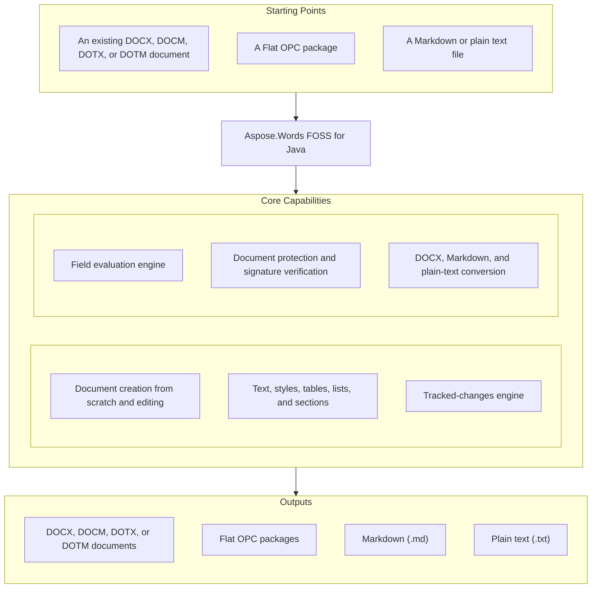

# Aspose.Words FOSS for Java

Open-source Java library for Word documents, built from the genuine Aspose.Words codebase. Create, read, and edit DOCX, convert to Markdown and plain text. No Microsoft Word required.

[](LICENSE)

## At a Glance



## Navigation

- [At a glance](#at-a-glance)
- [What it can do](#what-it-can-do)
- [Supported formats](#supported-formats)
- [Getting started](#getting-started)
- [Dependencies](#dependencies)
- [A quick example](#a-quick-example)
- [Additional examples](#additional-examples)
- [API reference](#api-reference)
- [What's not included](#whats-not-included-and-where-to-get-it)
- [Development and testing](#development-and-testing)
- [The story behind this code](#the-story-behind-this-code)
- [Documentation & resources](#documentation--resources)
- [Enjoying it? Star it](#enjoying-it-star-it-)
- [Contributing](#contributing)
- [License](#license)

## What it can do

- **Create documents from scratch** with the full document object model or the high-level `DocumentBuilder`.
- **Read and edit existing DOCX files**: text, formatting, styles, tables, lists, sections, headers and footers, bookmarks, comments, footnotes, shapes.
- **Convert** between DOCX, Markdown, and plain text.
- **Combine and reorganize documents**: append, clone, and import content between documents.
- **Find and replace** text with regular expressions and formatting-aware options.
- **Work with tracked changes**: inspect, accept, or reject revisions.
- **Update fields**: the full field evaluation engine is included, though values that depend on page layout (such as page numbers in a TOC) come out as placeholders (see [what's not included](#whats-not-included-and-where-to-get-it)).
- **Protect documents** and round-trip macro-enabled files (DOCM/DOTM) with their VBA projects intact.
- **Inspect and adjust embedded charts**: series values, axes, legend, and data-label formatting through `Chart`, `ChartSeries`, `ChartAxis`, and `ChartDataLabel`. Chart data round-trips intact; rendering the chart to an image is not part of this edition.
- **Verify digital signatures**: check whether a DOCX is signed and untampered, inspect the certificates, or remove signatures. (Creating new signatures is not included in this edition.)

The library is pure Java with no native code. It runs on Java 8 and later (checked with Java 8 and Java 17). No Office automation.

## Supported formats

| Format | Load | Save |
|---|:---:|:---:|
| DOCX / DOCM / DOTX / DOTM | ✅ | ✅ |
| Flat OPC (all variants) | ✅ | ✅ |
| Markdown | ✅ | ✅ |
| Plain text | ✅ | ✅ |

The engine underneath already knows how to handle far more (see [the story](#the-story-behind-this-code) below), and more formats may be opened over time. If you need a format that is not in the table, you have two options: [open an issue](../../issues) to request it, and we will consider open-sourcing it, or get it right away in the commercial [Aspose.Words for Java](https://products.aspose.com/words/java/), which reads and writes all of them today.

## Getting started

A Maven package is not published yet. Either download the jar, alone or with its dependencies, from [Releases](../../releases), or build it from source. To build it you need a JDK 8 (the build is verified with it) and `git` with [Git LFS](https://git-lfs.com). The repository keeps its binary files in Git LFS: the bundled Apache Ant, the two patched jars, a font and textures. Without Git LFS a clone gets placeholder files and the build cannot start.

```bash
git clone https://github.com/aspose-words-foss/Aspose.Words-FOSS-for-Java.git
cd Aspose.Words-FOSS-for-Java
libs-internal-tools/ant/bin/ant -f words-java.foss.build.xml -Djdk.home=/path/to/jdk8 jar
```

On Windows run `libs-internal-tools\ant\bin\ant.bat` instead. The build first downloads the third-party libraries it needs from Maven Central into `libs/` (and checks their SHA-256 sums), then compiles everything into one jar: `lib/aspose-words-foss.jar`. The package is `com.aspose.words`, the same as in the commercial product, so existing Aspose.Words for Java code compiles against it as is.

Put the jar and its [runtime dependencies](#required-runtime-dependencies) on your class path.

## Dependencies

### Required Runtime Dependencies

Two libraries in [`ms/lib`](ms/lib), modified by Aspose; what was changed and how to rebuild them is in [`third-party/`](third-party/README.md):

- `woodstox-core-6.5.2-aspose.jar` — Woodstox 6.5.1 (StAX XML parser) with an option to keep white space in attribute values, as .NET does.
- `bc-fips.jar` — the Bouncy Castle FIPS Java API (bc-fips 2.0.0, bcutil-fips 2.0.3, bcpkix-fips 2.0.7) merged into one jar, used for document encryption and signature verification. **It is not the certified FIPS 140 module.**

From Maven Central, downloaded by the build into `libs/`:

- `org.codehaus.woodstox:stax2-api:4.2.1` — the StAX2 API that Woodstox implements.
- `com.twelvemonkeys.imageio:imageio-core`, `imageio-metadata`, `imageio-tiff`, `imageio-webp` and `com.twelvemonkeys.common:common-lang`, `common-io`, `common-image`, all 3.12.0 — image reading and writing (TIFF, WebP).
- `org.sejda.imageio:webp-imageio:0.1.6` — WebP encoding.
- `com.pngencoder:pngencoder:0.15.0` — PNG encoding.

### Native and System Requirements

- A Java 8 or later runtime. Nothing native: no DLLs, no JNI, no Office.

### Development Dependencies

- `org.testng:testng:6.8` with `com.beust:jcommander:1.27` and `org.yaml:snakeyaml:1.6` — the test framework.
- `xmlunit:xmlunit:1.2` — XML comparison in tests.
- `net.java.dev.jna:jna:5.16.0`, `jna-platform:5.16.0` — used by a test tool only.
- Apache Ant 1.9.13, bundled in `libs-internal-tools/ant`.

None of these are needed at run time. Licences of everything above: [THIRD-PARTY-NOTICES.md](THIRD-PARTY-NOTICES.md).

## A quick example

```java
import com.aspose.words.*;

// Create a document from scratch.
Document doc = new Document();
DocumentBuilder builder = new DocumentBuilder(doc);

builder.getParagraphFormat().setStyleIdentifier(StyleIdentifier.HEADING_1);
builder.writeln("Hello from Aspose.Words FOSS!");

builder.getParagraphFormat().setStyleIdentifier(StyleIdentifier.BODY_TEXT);
builder.writeln("This document was created entirely in code, no Word installed.");

doc.save("Hello.docx");

// Convert an existing document to Markdown.
Document report = new Document("Report.docx");
report.save("Report.md");
```

The API is the same as in the commercial Aspose.Words for Java, so the [official documentation and examples](https://docs.aspose.com/words/java/) largely apply here too, within the supported feature set. In Java, .NET properties become `getX()` / `setX()` methods and enumerations are classes of `int` constants such as `StyleIdentifier.HEADING_1`.

## Additional Examples

More complete examples for tracked changes, document merging, and chart inspection are below; more recipes live in [`AGENTS.md`](AGENTS.md).

### Accept All Tracked Changes

```java
import com.aspose.words.*;

Document doc = new Document("reviewed.docx");
doc.acceptAllRevisions();
doc.save("final.docx");
```

<details>
<summary>View Additional Examples</summary>

### Merge Two Documents

```java
import com.aspose.words.*;

Document main = new Document("main.docx");
Document appendix = new Document("appendix.docx");
main.appendDocument(appendix, ImportFormatMode.KEEP_SOURCE_FORMATTING);
main.save("combined.docx");
```

### Convert Markdown to DOCX

```java
import com.aspose.words.*;

Document doc = new Document("notes.md");
doc.save("notes.docx");
```

### Read and Adjust an Embedded Chart's Data Labels

`doc` holds a line chart; data-label positions depend on the chart type:

```java
import com.aspose.words.*;

Shape shape = (Shape) doc.getChild(NodeType.SHAPE, 0, true);
Chart chart = shape.getChart();
ChartSeries series = chart.getSeries().get(0);

series.hasDataLabels(true);
series.getDataLabels().setShowValue(true);

ChartDataLabel label = series.getDataLabels().get(1);
label.setShowCategoryName(true);
label.setPosition(ChartDataLabelPosition.BELOW);

doc.save("chart-updated.docx");
```

</details>

## API Reference

The primary entry point is `Document`, loaded from a file, stream, or created empty, and edited through its node tree (`Section`, `Body`, `Paragraph`, `Run`, `Table`, and more) or the cursor-based `DocumentBuilder`. The classes used most often day to day:

<details>
<summary>View the Most Used Classes and Members</summary>

### Document and DocumentBuilder

- `Document`
  - `Document()` / `Document(fileName)` / `Document(fileName, loadOptions)` / `Document(stream)` / `Document(stream, loadOptions)`
  - `save(fileName)` / `save(fileName, saveFormat)` / `save(fileName, saveOptions)` / `save(stream, saveFormat)` / `save(stream, saveOptions)`
  - `getText()`
  - `appendDocument(srcDoc, importFormatMode)`, `importNode(srcNode, isImportChildren)`
  - `startTrackRevisions(author, dateTime)` / `stopTrackRevisions()` / `acceptAllRevisions()`
  - `updateFields()`, `updateTableLayout()`, `updateListLabels()`
  - `protect(type, password)` / `unprotect(password)`
  - `getFirstSection()`, `getLastSection()`, `getSections()`, `getStyles()`, `getRevisions()`, `getTrackRevisions()`, `hasRevisions()`, `getDigitalSignatures()`, `getBuiltInDocumentProperties()`, `getProtectionType()`, `getOriginalLoadFormat()`
- `DocumentBuilder`
  - `DocumentBuilder()` / `DocumentBuilder(doc)`
  - `write(text)` / `writeln(text)` / `writeln()`
  - `insertParagraph()`, `insertBreak(breakType)`, `insertField(fieldCode)`, `insertHyperlink(displayText, urlOrBookmark, isBookmark)`
  - `insertImage(fileName, width, height)`, `insertChart(chartType, width, height)`
  - `startTable()` / `insertCell()` / `endRow()` / `endTable()`
  - `startBookmark(bookmarkName)` / `endBookmark(bookmarkName)`
  - `getDocument()`, `getFont()`, `getParagraphFormat()`, `getListFormat()`, `getPageSetup()`, `getCurrentParagraph()`, `getCurrentSection()`
- `SaveFormat` — `DOCX`, `DOCM`, `DOTX`, `DOTM`, `FLAT_OPC`, `FLAT_OPC_MACRO_ENABLED`, `FLAT_OPC_TEMPLATE`, `FLAT_OPC_TEMPLATE_MACRO_ENABLED`, `TEXT`, `MARKDOWN`, plus values inherited from the shared engine that are not functional in this edition
- `LoadFormat` — `AUTO`, `DOCX`, `DOCM`, `DOTX`, `DOTM`, `FLAT_OPC`, `FLAT_OPC_MACRO_ENABLED`, `FLAT_OPC_TEMPLATE`, `FLAT_OPC_TEMPLATE_MACRO_ENABLED`, `TEXT`, `MARKDOWN`, plus values that are not functional in this edition
- `LoadOptions` — `LoadOptions()` / `LoadOptions(password)` / `LoadOptions(loadFormat, password, baseUri)`

### Document Structure

- `Section`, `Body`, `Paragraph`, `Run` — the core node tree; each `Node` supports `getText()`, `deepClone(isCloneChildren)`, `remove()`, and each `CompositeNode` also `getChildNodes(nodeType, isDeep)`
- `Table`, `Row`, `Cell` — table structure, built with `DocumentBuilder.startTable()` / `insertCell()` / `endRow()` / `endTable()`
- `Bookmark` — `getName()`, `getText()`, `getBookmarkStart()`, `getBookmarkEnd()`, `remove()`; `BookmarkCollection`
- `HeaderFooter` — `HeaderFooter(doc, headerFooterType)`, `appendParagraph(text)`, `getText()`; reached via `DocumentBuilder.moveToHeaderFooter(headerFooterType)`
- `Comment`, `Footnote` — footnotes via `DocumentBuilder.insertFootnote(footnoteType, footnoteText)`; comments carry author, date, and reply threading
- `Style`, `StyleCollection` — `getName()`, `getStyleIdentifier()`, `getType()`, `getBaseStyleName()`; `Font` — `getName()`, `getNameAscii()` / `getNameBi()` / `getNameFarEast()` / `getNameOther()`, `clearFormatting()`
- `ParagraphFormat` — `getAlignment()`, `getKeepTogether()`, `getKeepWithNext()`, `getPageBreakBefore()`, `clearFormatting()` (each getter has its setter)

### Fields, Tracked Changes, Protection, and Signatures

- `Field` — `getFieldCode()`, `update()`, `unlink()`, `remove()`, `getType()`, `getResult()`; `FieldCollection` — `remove(field)`, `clear()`, `getCount()`
- `Revision` — `accept()` / `reject()`, `getAuthor()`, `getDateTime()`, `getRevisionType()`; `RevisionCollection` — `acceptAll()` / `rejectAll()`, `getGroups()`
- `DigitalSignature` — `getSignatureType()`, `getSignTime()`, `getSubjectName()`, `getIssuerName()`, `isValid()`, `getCertificateHolder()`; `DigitalSignatureCollection` — read-only, `isValid()`, `getCount()`
- `CertificateHolder` — `create(certBytes, password)` / `create(fileName, password)`

### Charts

- `Chart` — `getSeries()`, `getLegend()`, `getTitle()`, `getAxisX()` / `getAxisY()` / `getAxisZ()`, `getDataTable()`
- `ChartSeries` — `add(xValue, yValue)`, `insert(index, xValue, yValue)`, `remove(index)`, `clear()`, `clearValues()`
- `ChartAxis` — `getType()`, `getCategoryType()`, `getCrosses()`, `getMajorUnit()`, `getMajorTickMark()`, `getMinorTickMark()`
- `ChartLegend` — `getLegendEntries()`, `getPosition()`, `getFont()`
- `ChartDataLabel` — `getShowValue()`, `getShowCategoryName()`, `getShowPercentage()`, `getPosition()`, `clearFormat()`

</details>

The public API of this edition matches the .NET edition, [Aspose.Words FOSS for .NET](https://github.com/aspose-words-foss/Aspose.Words-FOSS-for-.NET), whose README lists every public type; the [Aspose.Words for Java API reference](https://reference.aspose.com/words/java/) documents each of them in Java form.

## What's not included (and where to get it)

To keep this edition free, the subsystems that power Aspose's commercial offering were removed. To be upfront about it:

- **Page layout and rendering.** No saving to PDF, XPS, or images, and no printing. This also means layout-dependent field values (such as page numbers in a TOC or `NUMPAGES`) evaluate to `0` rather than being computed.
- **Additional formats.** DOC, RTF, ODT, HTML, EPUB, and others are not read or written in this edition.
- **Mail merge, LINQ Reporting, document comparison, document signing, and embedded-font subsetting** are not included.

One important thing to know: what's included today is the *minimum*, the commercial codebase reduced as far as it would go. It is not the final shape of the project, and the boundary is not set in stone. If a feature you need sits on the wrong side of it, [open an issue](../../issues) and tell us about your use case. Where there is real demand, we will consider opening up more of the code.

If your project grows into needing any of the above, the commercial [Aspose.Words for Java](https://products.aspose.com/words/java/) has all of it. And because this library *is* that codebase, upgrading is essentially swapping the jar. Your code carries over.

## Development and Testing

Requirements: a JDK 8. Everything else comes with the repository or is downloaded by the build. The test suite (TestNG, about 18,000 tests) reads its input documents and gold files from the .NET edition, [Aspose.Words FOSS for .NET](https://github.com/aspose-words-foss/Aspose.Words-FOSS-for-.NET). The Ant target `fetch-test-data` downloads just those folders (about 700 MB, as Git LFS objects) of the .NET release this code was ported from into `test-data/`; it needs `git` with [Git LFS](https://git-lfs.com). Then build and run:

```bash
libs-internal-tools/ant/bin/ant -f words-java.foss.build.xml fetch-test-data
libs-internal-tools/ant/bin/ant -f words-java.foss.build.xml -Djdk.home=/path/to/jdk8 -Dms.flavour=debug compile compile.tests test
```

`-Dms.flavour=debug` compiles in the test-mode behaviour the gold files expect (a predictable random generator, for example). If you already have a clone of the .NET repository at the matching release, pass `-Dnet.dir=<path>` instead of fetching. TestNG writes its report to `test-output/`; gold files that differ in Java are in `TestGoldJava/`. The suite is maintained on Windows, and two tests depend on the folder layout of Aspose's own machines. A third, `TestBidiAlgorithmConformance`, fails on the 26.3 test data: the code expects its Unicode data file at a new path, which comes with the next .NET release.

The repository is also an IntelliJ IDEA project: open the folder, set a JDK 8 as the project SDK, and use the run configurations `all`, `words`, `foundation` and `ms`. They read the test data from `test-data/`; run the Ant target `test` once first, because it also creates the output folders some Foundation tests write into. See [`AGENTS.md`](AGENTS.md) for the project layout and how the code is produced.

## The story behind this code

Most open-source Word libraries start from zero and work their way up the OOXML spec. This one went the other way. It is not a rewrite or a wrapper: it is the actual Aspose.Words source code, the same document engine that has processed Word documents in production since 2003.

Aspose.Words has been in continuous development for over two decades, and it is older than DOCX itself. The library began with manual reverse engineering of the binary DOC format, at a time when no public specification existed. Then came WordML, the Word 2003 XML dialect, then OOXML when Word 2007 arrived, and one format after another in the years since. The engine is written in C#; Aspose.Words for Java has always been produced from that same C# code by Aspose's own C#-to-Java porter, together with a hand-written layer for what differs between the platforms, including `com.aspose.ms`, a Java implementation of the .NET base classes the ported code uses.

This edition follows the same path. [Aspose.Words FOSS for .NET](https://github.com/aspose-words-foss/Aspose.Words-FOSS-for-.NET) was made by reducing the full commercial source: the commercial subsystems (page layout, rendering, the long tail of format converters, and the licensing machinery) were removed, along with internal infrastructure and materials not meant for publication. That reduced C# tree was then run through the porter, the hand-written Java was trimmed to match, and everything third-party was audited so that the result can be published under the MIT licence. What remains is the genuine core: the document model, the DOCX reader and writer, and thousands of small fixes for real-world documents that only accumulate after twenty years of production use. The port and the clean-up were carried out with the help of [Claude](https://claude.com), Anthropic's AI assistant.

That is also why the source is worth a read. This is production code, not a demonstration. If you have ever wondered what it actually takes to handle Word documents correctly, it is all in here.

## Documentation & Resources

- **[Aspose.Words for Java documentation](https://docs.aspose.com/words/java/)** — the API is the same, so its guides and examples largely apply here too, within this edition's supported feature set.
- **[Aspose.Words for Java API reference](https://reference.aspose.com/words/java/)** — every public type, in Java form.
- **[Aspose.Words FOSS for .NET](https://github.com/aspose-words-foss/Aspose.Words-FOSS-for-.NET)** — the C# code this library is ported from.
- **[Agent and contributor guide](AGENTS.md)** — usage recipes for AI coding assistants, plus build, test, and layout notes for anyone changing this repository.
- **[Third-party notices](THIRD-PARTY-NOTICES.md)** and **[modified third-party libraries](third-party/README.md)**.
- Found a bug or have a feature request? [Open an issue](https://github.com/aspose-words-foss/Aspose.Words-FOSS-for-Java/issues) on GitHub — pull requests are welcome too; for anything non-trivial, open an issue first so the approach can be discussed.

## Enjoying it? Star it ⭐

This project is brand new, and stars are how GitHub decides whether anyone else gets to discover it. If Aspose.Words FOSS looks useful to you:

- **Star** the repo. It takes one click and helps more than anything else.
- **Watch** it (Releases only is fine) to hear about new features first.
- **Tell someone.** A mention in a blog post, a team chat, or an answer on Stack Overflow means a lot to a young project.

## Contributing

Bug reports and feature requests are very welcome, please [open an issue](../../issues). Pull requests are considered case by case; for anything non-trivial, it is best to open an issue first so we can discuss the approach. Most of the Java code is generated from the C# code of the .NET edition, so a fix to a generated file usually belongs there; [`AGENTS.md`](AGENTS.md) explains how to tell.

## License

[MIT](LICENSE). Free for commercial and personal use. Third-party components and their licences are listed in
[THIRD-PARTY-NOTICES.md](THIRD-PARTY-NOTICES.md).
