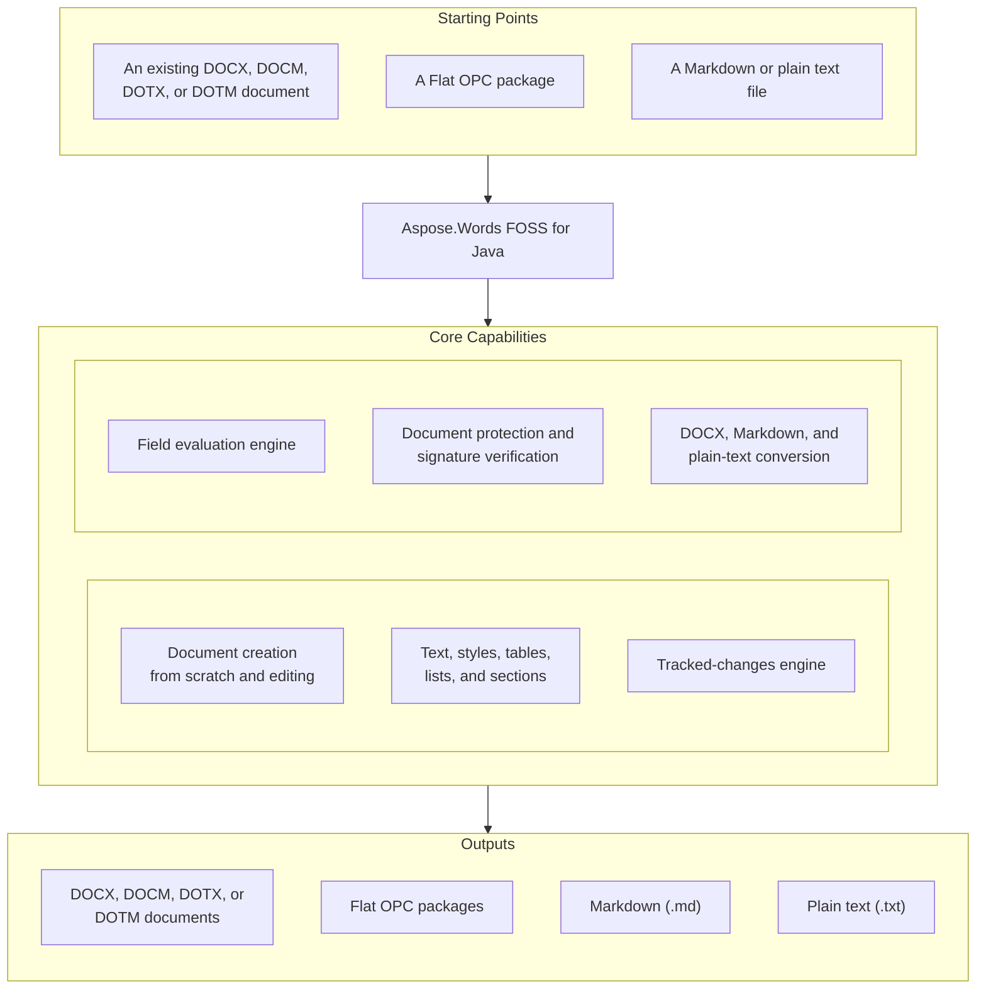

# Aspose.Words FOSS for Java

[](https://central.sonatype.com/artifact/org.aspose/aspose-words-foss) [](LICENSE) [](https://github.com/aspose-words-foss/Aspose.Words-FOSS-for-Java/graphs/contributors)

[](https://products.aspose.org/words/java/)

### Project History

Most open-source Word libraries start from zero and work their way up the OOXML spec. This one went the other way. It is not a rewrite or a wrapper: it is the actual Aspose.Words source code, the same document engine that has processed Word documents in production since 2003.

Aspose.Words has been in continuous development for over two decades, and it is older than DOCX itself. The library began with manual reverse engineering of the binary DOC format, at a time when no public specification existed. Then came WordML, the Word 2003 XML dialect, then OOXML when Word 2007 arrived, and one format after another in the years since. The engine is written in C#; Aspose.Words for Java has always been produced from that same C# code by Aspose's own C#-to-Java porter, together with a hand-written layer for what differs between the platforms, including `com.aspose.ms`, a Java implementation of the .NET base classes the ported code uses.

This edition follows the same path. [Aspose.Words FOSS for .NET](https://github.com/aspose-words-foss/Aspose.Words-FOSS-for-.NET) was made by reducing the full commercial source: the commercial subsystems (page layout, rendering, the long tail of format converters, and the licensing machinery) were removed, along with internal infrastructure and materials not meant for publication. That reduced C# tree was then run through the porter, the hand-written Java was trimmed to match, and everything third-party was audited so that the result can be published under the MIT licence. What remains is the genuine core: the document model, the DOCX reader and writer, and thousands of small fixes for real-world documents that only accumulate after twenty years of production use. The port and the clean-up were carried out with the help of [Claude](https://claude.com), Anthropic's AI assistant.

That is also why the source is worth a read. This is production code, not a demonstration. If you have ever wondered what it actually takes to handle Word documents correctly, it is all in here.

Aspose.Words FOSS for Java is a free, open-source Java word processing library built from the genuine Aspose.Words codebase. Use it as a free Java library to read DOCX files, to create Word documents from scratch, to edit existing documents, and to convert them to Markdown and plain text, with no Microsoft Word installation or Office automation required. It is an open source Java API for Word documents, published on Maven Central under the MIT license.

## Navigation

- [At a Glance](#at-a-glance)
- [Key Capabilities](#key-capabilities)
- [Installation](#installation)
- [Dependencies](#dependencies)
- [Quick Start](#quick-start)
- [Additional Examples](#additional-examples)
- [API Reference](#api-reference)
- [Documentation & Resources](#documentation--resources)
- [Scope and Limitations](#scope-and-limitations)
- [Development and Testing](#development-and-testing)
- [License](#license)

## At a Glance



## Key Capabilities

- Create Word documents from scratch with the full document object model or the high-level `DocumentBuilder`, and save them as DOCX.
- `Document` reads and edits existing DOCX files: text, formatting, styles, tables, lists, sections, headers and footers, bookmarks, comments, footnotes, and shapes are reachable through the node tree.
- Convert between DOCX, Markdown, and plain text by loading one format and saving another. Markdown output starts with a UTF-8 byte-order mark.
- Combine and reorganize documents with `appendDocument`, `deepClone`, and `importNode`, which append, clone, and import content between documents.
- Find and replace text with regular expressions and formatting-aware options.
- Work with tracked changes: inspect, accept, or reject revisions with `Revision` and `RevisionCollection`.
- Update fields with the full field evaluation engine (`Document.updateFields()`). Values that depend on page layout come out as placeholders: after an update the results of `PAGE` and `NUMPAGES` fields were empty in a test, and a table of contents without entries reads "No table of contents entries found".
- Protect documents with `protect` and `unprotect`, open and save password-protected (encrypted) DOCX files, and round-trip macro-enabled files (DOCM/DOTM) with their VBA modules and macro source intact (the `vbaProject.bin` part is written again, not copied byte for byte).
- Inspect and adjust embedded charts: series values, axes, legend, and data-label formatting through `Chart`, `ChartSeries`, `ChartAxis`, and `ChartDataLabel`. Chart data round-trips intact; rendering the chart to an image is not part of this edition.
- Verify digital signatures: check whether a DOCX is signed and untampered, inspect the certificates, or remove signatures. Creating new signatures is not included in this edition.

Supported formats:

| Format | Load | Save |
|---|:---:|:---:|
| DOCX / DOCM / DOTX / DOTM | ✅ | ✅ |
| Flat OPC (all variants) | ✅ | ✅ |
| Markdown | ✅ | ✅ |
| Plain text | ✅ | ✅ |

The engine underneath handles more formats than this edition exposes (see [the story](#project-history) above). If you need a format that is not in the table, [open an issue](../../issues) to request it, or use the commercial [Aspose.Words for Java — Enterprise Edition](https://products.aspose.com/words/java/), which has the full feature set and reads and writes all of them.

## Installation

The package is on Maven Central:

```xml
<dependency>
  <groupId>org.aspose</groupId>
  <artifactId>aspose-words-foss</artifactId>
  <version>26.3.0</version>
</dependency>
```

or, with Gradle:

```groovy
implementation 'org.aspose:aspose-words-foss:26.3.0'
```

Maven and Gradle also fetch the ten ordinary libraries listed under [Dependencies](#dependencies); the two modified libraries are already inside this jar. The jar, its sources and javadoc jars, their signatures and a `SHA256SUMS` file are also attached to each [Release](../../releases).

To build it from source you need a JDK 8 (the build is verified with it) and `git` with [Git LFS](https://git-lfs.com). The repository keeps its binary files in Git LFS: the bundled Apache Ant, the two patched jars, a font and textures. Without Git LFS a clone gets placeholder files and the build cannot start.

```bash
git clone https://github.com/aspose-words-foss/Aspose.Words-FOSS-for-Java.git
cd Aspose.Words-FOSS-for-Java
libs-internal-tools/ant/bin/ant -f words-java.foss.build.xml -Djdk.home=/path/to/jdk8 jar
```

On Windows run `libs-internal-tools\ant\bin\ant.bat` instead. The build first downloads the third-party libraries it needs from Maven Central into `libs/` (and checks their SHA-256 sums), then compiles everything into one jar: `lib/aspose-words-foss.jar`. The package is `com.aspose.words`, the same as in the commercial product, so existing Aspose.Words for Java code compiles against it as is, as long as it only uses the features this edition supports; code that uses the removed subsystems (PDF and image output, mail merge, page layout, reporting) does not compile. For the same reason, do not put both jars on one class path.

If you built the jar with Ant, put it and its [runtime dependencies](#required-package-dependencies) on your class path. The jar from Maven Central needs no extra step: your build tool resolves the ordinary libraries.

The "Source code (zip)" and "Source code (tar.gz)" archives that GitHub offers on the Release page do not contain Git LFS files, so they cannot be built: the build stops at once with "The bundled jars are Git-LFS pointer text". Use the Maven Central or Release jar, or clone the repository with Git LFS.

## Dependencies

### Required Package Dependencies

The Maven Central jar contains two libraries, modified by Aspose, unpacked into it under their original package names; with the Ant build they stay separate jars in [`ms/lib`](ms/lib). What was changed and how to rebuild them is in [`third-party/`](third-party/README.md). Dependency scanners cannot see classes bundled inside a jar, so the jar's manifest lists them in `Bundled-Dependencies`. `woodstox-core-6.5.2-aspose.jar` is Woodstox 6.5.1 (a StAX XML parser) with an option to keep white space in attribute values, as .NET does. `bc-fips.jar` is the Bouncy Castle FIPS Java API (`bc-fips` 2.0.0, `bcutil-fips` 2.0.3 and `bcpkix-fips` 2.0.7) merged into one jar, and is used for document encryption and signature verification. **It is not the certified FIPS 140 module.**

Ten ordinary libraries come from Maven Central (the Ant build downloads them into `libs/`):

- `org.codehaus.woodstox:stax2-api` 4.2.1 is the StAX2 API that Woodstox implements.
- `com.twelvemonkeys.imageio:imageio-core` 3.12.0, for image reading and writing.
- `com.twelvemonkeys.imageio:imageio-metadata` 3.12.0, for image metadata.
- `com.twelvemonkeys.imageio:imageio-tiff` 3.12.0, for TIFF.
- `com.twelvemonkeys.imageio:imageio-webp` 3.12.0, for WEBP reading.
- `com.twelvemonkeys.common:common-lang` 3.12.0, `com.twelvemonkeys.common:common-io` 3.12.0 and `com.twelvemonkeys.common:common-image` 3.12.0, the shared TwelveMonkeys base libraries.
- `org.sejda.imageio:webp-imageio` 0.1.6, for WEBP encoding.
- `com.pngencoder:pngencoder` 0.15.0, for PNG encoding.

### Native and System Requirements

- A Java 8 or later runtime, tested with Java 8, 17 and 21. The class files are compiled for Java 7 (`maven.compiler.target` is `1.7` in `pom.xml`).
- The library's own code has no JNI and needs no Office installation. The `webp-imageio` dependency bundles native WEBP codec libraries for Windows, Linux and macOS, so the jar set as a whole is not free of native code.

The licences of everything named in this section are listed in [`THIRD-PARTY-NOTICES.md`](THIRD-PARTY-NOTICES.md). The libraries that only the test suite and the Ant build use are described under [Development and Testing](#development-and-testing); none of them is needed at run time.

## Quick Start

```java
import com.aspose.words.*;

// Create a document from scratch.
Document doc = new Document();
DocumentBuilder builder = new DocumentBuilder(doc);

builder.getParagraphFormat().setStyleIdentifier(StyleIdentifier.HEADING_1);
builder.writeln("Hello from Aspose.Words FOSS!");

builder.getParagraphFormat().setStyleIdentifier(StyleIdentifier.BODY_TEXT);
builder.writeln("This document was created entirely in code, no Word installed.");

doc.save("Hello.docx");

// Convert an existing document to Markdown.
Document report = new Document("Hello.docx");
report.save("Hello.md");
```

The API is the same as in the commercial Aspose.Words for Java, so the [Enterprise Edition documentation and examples](https://docs.aspose.com/words/java/) largely apply here too, within the supported feature set. In Java, .NET properties become `getX()` / `setX()` methods and enumerations are classes of `int` constants such as `StyleIdentifier.HEADING_1`.

## Additional Examples

More recipes for the tracked-changes, merging, Markdown, and chart tasks are below; further recipes live in [`AGENTS.md`](AGENTS.md).

### Accept All Tracked Changes

Accept all tracked changes in a document:

```java
import com.aspose.words.*;

// Record a change as a tracked revision and save the reviewed copy.
Document draft = new Document();
DocumentBuilder builder = new DocumentBuilder(draft);
builder.writeln("Original text.");
draft.startTrackRevisions("Reviewer");
builder.writeln("Text added during review.");
draft.stopTrackRevisions();
draft.save("reviewed.docx");

// Accept every tracked change and save the final document.
Document doc = new Document("reviewed.docx");
doc.acceptAllRevisions();
doc.save("final.docx");
```

<details>
<summary>View Additional Examples</summary>

### Merge Two Documents

```java
import com.aspose.words.*;

Document main = new Document();
new DocumentBuilder(main).writeln("Main document.");
Document appendix = new Document();
new DocumentBuilder(appendix).writeln("Appendix.");

main.appendDocument(appendix, ImportFormatMode.KEEP_SOURCE_FORMATTING);
main.save("combined.docx");
```

### Convert Markdown to DOCX

```java
import com.aspose.words.*;
import java.nio.charset.StandardCharsets;
import java.nio.file.Files;
import java.nio.file.Paths;

Files.write(Paths.get("notes.md"), "# Notes\n\nSome **bold** text.\n".getBytes(StandardCharsets.UTF_8));

Document doc = new Document("notes.md");
doc.save("notes.docx");
```

### Read and Adjust an Embedded Chart's Data Labels

Data-label positions depend on the chart type; this example uses a line chart:

```java
import com.aspose.words.*;

// Build a document with a line chart, then read it back and adjust its data labels.
Document doc = new Document();
DocumentBuilder builder = new DocumentBuilder(doc);
Shape inserted = builder.insertChart(ChartType.LINE, 432, 252);
inserted.getChart().getSeries().clear();
inserted.getChart().getSeries().add("Sales", new String[] {"Q1", "Q2", "Q3"}, new double[] {10, 20, 15});
doc.save("chart.docx");

Document reloaded = new Document("chart.docx");
Shape shape = (Shape) reloaded.getChild(NodeType.SHAPE, 0, true);
Chart chart = shape.getChart();
ChartSeries series = chart.getSeries().get(0);

series.hasDataLabels(true);
series.getDataLabels().setShowValue(true);

ChartDataLabel label = series.getDataLabels().get(1);
label.setShowCategoryName(true);
label.setPosition(ChartDataLabelPosition.BELOW);

reloaded.save("chart-updated.docx");
System.out.println("series: " + series.getName() + ", labels shown: " + series.hasDataLabels());
```

</details>

## API Reference

The primary entry point is `Document`, loaded from a file or stream or created empty, and edited through its node tree (`Section`, `Body`, `Paragraph`, `Run`, `Table`, and more) or the cursor-based `DocumentBuilder`. The library ships 634 public types organized into 36 modules.

<details>
<summary>View the Full API Surface</summary>

### Core API

| Class | Description |
|---|---|
| `CurrentThreadSettings` | This class helps to set thread-isolated Locale and Time Zone for a Aspose.Words application. |
| `FipsUnapprovedOperationException` | Represents the exception that is thrown when incorrectly trying to use cryptography. |
| `NativeLibSettings` | Process-wide options of the library: the folder for temporary files and the reaction to image errors. |
| `OverflowException` | Map for .Net's System.OverflowException. |
| `Ref` | Represents Generic Out/Ref constructions /. |
| `RefBoolean` | Represents Out/Ref constructions for Boolean primitive type /. |
| `RefByte` | Represents Out/Ref constructions for Byte primitive type /. |
| `RefDouble` | Represents Out/Ref constructions for Double primitive type /. |
| `RefFloat` | Represents Out/Ref constructions for Float primitive type /. |
| `RefInt` | Represents Out/Ref constructions for Integer primitive type /. |
| `RefLong` | Represents Out/Ref constructions for Long primitive type /. |
| `RefPoint` | Represents Out/Ref constructions for Point struct /. |
| `RefPointF` | Represents Out/Ref constructions for PointF struct /. |
| `RefShort` | Represents Out/Ref constructions for Short primitive type /. |
| `RefSize` | Represents Out/Ref constructions for Size struct /. |
| `RefSizeF` | Represents Out/Ref constructions for SizeF struct /. |
| `X509Certificate2Wrapper` | JAVA-added public wrapper around ours internal X509Certificate2. |

### Bibliography

| Class | Description |
|---|---|
| `Bibliography` | Represents the list of bibliography sources available in the document. |
| `Contributor` | Represents a bibliography source contributor. |
| `ContributorCollection` | Represents bibliography source contributors. |
| `Corporate` | Represents a corporate (an organization) bibliography source contributor. |
| `Person` | Represents individual (a person) bibliography source contributor. |
| `PersonCollection` | Represents a list of persons who are bibliography source contributors. |
| `Source` | Represents an individual source, such as a book, journal article, or interview. |
| `SourceType` | Represents bibliography source types. |

### Bookmarks

| Class | Description |
|---|---|
| `Bookmark` | Represents a single bookmark. |
| `BookmarkCollection` | A collection of Bookmark objects that represent the bookmarks in the specified range. |
| `BookmarkEnd` | Represents an end of a bookmark in a Word document. |
| `BookmarkStart` | Represents a start of a bookmark in a Word document. |

### Borders

| Class | Description |
|---|---|
| `Border` | Represents a border of an object. |
| `BorderCollection` | A collection of Border objects. |
| `BorderType` | Specifies sides of a border. |
| `LineStyle` | Specifies line style of a Border. |
| `Shading` | Contains shading attributes for an object. |
| `TextureIndex` | Specifies shading texture. |

### Building Blocks

| Class | Description |
|---|---|
| `BuildingBlock` | BuildingBlock represents a reusable content block with properties such as name, GUID, description, gallery, category and behavior, and provides access to its underlying sections. |
| `BuildingBlockBehavior` | Specifies the behavior that shall be applied to the contents of the building block when it is inserted into the main document. |
| `BuildingBlockCollection` | A collection of BuildingBlock objects in the document. |
| `BuildingBlockGallery` | Specifies the predefined gallery into which a building block is classified. |
| `BuildingBlockType` | Specifies a building block type. |
| `GlossaryDocument` | Represents the root element for a glossary document within a Word document. |

### Date Time Formatting

| Class | Description |
|---|---|
| `CalendarType` | Specifies the type of a calendar. |

### Digital Signatures

| Class | Description |
|---|---|
| `CertificateHolder` | Represents a holder of X509Certificate2 instance. |
| `DigitalSignature` | Represents a digital signature on a document and the result of its verification. |
| `DigitalSignatureCollection` | Provides a read-only collection of digital signatures attached to a document. |
| `DigitalSignatureType` | Specifies the type of a digital signature. |
| `DigitalSignatureUtil` | Provides methods for signing document. |
| `SignOptions` | Allows to specify options for document signing. |
| `XmlDsigLevel` | Specifies the level of a digital signature based on XML-DSig standard. |

### Document

| Class | Description |
|---|---|
| `BreakType` | Specifies type of a break inside a document. |
| `BuildVersionInfo` | Provides information about the current product name and version. |
| `CleanupOptions` | Allows to specify options for document cleaning. |
| `ContentDisposition` | Enumerates different ways of presenting the document at the client browser. |
| `ConvertUtil` | Provides helper functions to convert between various measurement units. |
| `Document` | Represents a Word document. |
| `DocumentBase` | Provides the abstract base class for a main document and a glossary document of a Word document. |
| `DocumentBuilder` | Provides methods to insert text, images and other content, specify font, paragraph and section formatting. |
| `DocumentBuilderOptions` | Allows to specify additional options for the document building process. |
| `DocumentReaderPluginLoadException` | Thrown during document load, when the plugin required for reading the document format cannot be loaded. |
| `DocumentVisitor` | Base class for custom document visitors. |
| `FileCorruptedException` | Thrown during document load, when the document appears to be corrupted and impossible to load. |
| `FileFormatInfo` | Contains data returned by FileFormatUtil document format detection methods. |
| `FileFormatUtil` | Provides utility methods for working with file formats, such as detecting file format or converting file extensions to/from file format enums. |
| `HtmlInsertOptions` | Specifies options for the DocumentBuilder.insertHtml() method. |
| `IDocumentConverterPlugin` | Defines an interface for external converter plugin. |
| `IDocumentMergerPlugin` | Defines an interface for external merger plugin that can merge PDF documents. |
| `IDocumentReaderPlugin` | Defines an interface for external reader plugins that can read a file into a document. |
| `IWarningCallback` | Implement this interface if you want to have your own custom method called to capture loss of fidelity warnings that can occur during document loading or saving. |
| `ImportFormatOptions` | Allows to specify various import options to format output. |
| `IncorrectPasswordException` | Thrown if a document is encrypted with a password and the password specified when opening the document is incorrect or missing. |
| `LoadFormat` | Indicates the format of the document that is to be loaded. |
| `PlainTextDocument` | Allows to extract plain-text representation of the document's content. |
| `ProtectionType` | Protection type for a document. |
| `RevisionsView` | Allows to specify whether to work with the original or revised version of a document. |
| `SaveFormat` | Indicates the format in which the document is saved. |
| `SignatureLineOptions` | Allows to specify options for signature line being inserted. |
| `SubDocument` | Represents a SubDocument - which is a reference to an externally stored document. |
| `UnsupportedFileFormatException` | Thrown during document load, when the document format is not recognized or not supported by Aspose.Words. |
| `VariableCollection` | A collection of document variables. |
| `VisitorAction` | Allows the visitor to control the enumeration of nodes. |
| `WarningInfo` | Contains information about a warning that Aspose.Words issued during document loading or saving. |
| `WarningInfoCollection` | Represents a typed collection of WarningInfo objects. |
| `WarningSource` | Specifies the module that produces a warning during document loading or saving. |
| `WarningType` | Specifies the type of a warning that is issued by Aspose.Words during document loading or saving. |

### Drawing

| Class | Description |
|---|---|
| `Adjustment` | Represents adjustment values that are applied to the specified shape. |
| `AdjustmentCollection` | Represents a read-only collection of Adjustment adjust values that are applied to the specified shape. |
| `ArrowLength` | Length of the arrow at the end of a line. |
| `ArrowType` | Specifies the type of an arrow at a line end. |
| `ArrowWidth` | Width of the arrow at the end of a line. |
| `AxisBound` | Represents minimum or maximum bound of axis values. |
| `AxisBuiltInUnit` | Specifies the display units for an axis. |
| `AxisCategoryType` | Specifies type of a category axis. |
| `AxisCrosses` | Specifies the possible crossing points for an axis. |
| `AxisDisplayUnit` | Provides access to the scaling options of the display units for the value axis. |
| `AxisGroup` | Represents a type of a chart axis group. |
| `AxisScaleType` | Specifies the possible scale types for an axis. |
| `AxisScaling` | Represents the scaling options of the axis. |
| `AxisTickLabelPosition` | Specifies the possible positions for tick labels. |
| `AxisTickLabels` | Represents properties of axis tick mark labels. |
| `AxisTickMark` | Specifies the possible positions for tick marks. |
| `AxisTimeUnit` | Specifies the unit of time for axes. |
| `BubbleSizeCollection` | Represents a collection of bubble sizes for a chart series. |
| `Chart` | Provides access to the chart shape properties. |
| `ChartAxis` | Represents the axis options of the chart. |
| `ChartAxisCollection` | Represents a collection of chart axes. |
| `ChartAxisTitle` | Provides access to the axis title properties. |
| `ChartAxisType` | Specifies type of chart axis. |
| `ChartDataLabel` | Represents data label on a chart point or trendline. |
| `ChartDataLabelCollection` | Represents a collection of ChartDataLabel. |
| `ChartDataLabelLocationMode` | Specifies how the values ​​that specify the location of a data label - the ChartDataLabel.getLeft() and ChartDataLabel.getTop() properties - are interpreted. |
| `ChartDataLabelPosition` | Specifies the position for a chart data label. |
| `ChartDataPoint` | Allows to specify formatting of a single data point on the chart. |
| `ChartDataPointCollection` | Represents collection of a ChartDataPoint. |
| `ChartDataTable` | Allows to specify properties of a chart data table. |
| `ChartFormat` | Represents the formatting of a chart element. |
| `ChartLegend` | Represents chart legend properties. |
| `ChartLegendEntry` | Represents a chart legend entry. |
| `ChartLegendEntryCollection` | Represents a collection of chart legend entries. |
| `ChartMarker` | Represents a chart data marker. |
| `ChartMultilevelValue` | Represents a value for charts that display multilevel data. |
| `ChartNumberFormat` | Represents number formatting of the parent element. |
| `ChartSeries` | Represents chart series properties. |
| `ChartSeriesCollection` | Represents collection of a ChartSeries. |
| `ChartSeriesGroup` | Represents properties of a chart series group, that is, the properties of chart series of the same type associated with the same axes. |
| `ChartSeriesGroupCollection` | Represents a collection of ChartSeriesGroup objects. |
| `ChartSeriesType` | Specifies a type of a chart series. |
| `ChartShapeType` | Specifies the shape type of chart elements. |
| `ChartStyle` | Specifies predefined styles of a chart. |
| `ChartTitle` | Provides access to the chart title properties. |
| `ChartType` | Specifies type of a chart. |
| `ChartXValue` | Represents an X value for a chart series. |
| `ChartXValueCollection` | Represents a collection of X values for a chart series. |
| `ChartXValueType` | Allows to specify type of an X value of a chart series. |
| `ChartYValue` | Represents an Y value for a chart series. |
| `ChartYValueCollection` | Represents a collection of Y values for a chart series. |
| `ChartYValueType` | Allows to specify type of an Y value of a chart series. |
| `DashStyle` | Dashed line style. |
| `EndCap` | Specifies line cap style. |
| `Fill` | Represents fill formatting for an object. |
| `FillType` | Specifies fill type for a fillable object. |
| `FlipOrientation` | Possible values for the orientation of a shape. |
| `Forms2OleControl` | Represents Microsoft Forms 2.0 OLE control. |
| `Forms2OleControlCollection` | Represents collection of Forms2OleControl objects. |
| `Forms2OleControlType` | Enumerates types of Forms 2.0 controls. |
| `GlowFormat` | Represents the glow formatting for an object. |
| `GradientStop` | Represents one gradient stop. |
| `GradientStopCollection` | Contains a collection of GradientStop objects. |
| `GradientStyle` | Specifies the style for a gradient fill. |
| `GradientVariant` | Specifies the variant for a gradient fill. |
| `GroupShape` | Represents a group of shapes in a document. |
| `HorizontalAlignment` | Specifies horizontal alignment of a floating shape, text frame or floating table. |
| `HorizontalRuleAlignment` | Represents the alignment for the specified horizontal rule. |
| `HorizontalRuleFormat` | Represents horizontal rule formatting. |
| `IChartDataPoint` | Contains properties of a single data point on the chart. |
| `ImageData` | Defines an image for a shape. |
| `ImageSize` | Contains information about image size and resolution. |
| `ImageType` | Specifies the type (format) of an image in a Microsoft Word document. |
| `ImageWatermarkOptions` | Contains options that can be specified when adding a watermark with image. |
| `JoinStyle` | Line join style. |
| `LayoutFlow` | Determines the flow of the text layout in a textbox. |
| `LegendPosition` | Specifies the possible positions for a chart legend. |
| `MarkerSymbol` | Specifies marker symbol style. |
| `OleControl` | Represents OLE ActiveX control. |
| `OleFormat` | Provides access to the data of an OLE object or ActiveX control. |
| `OlePackage` | Allows to access OLE Package properties. |
| `PatternType` | Specifies the fill pattern to be used to fill a shape. |
| `PresetTexture` | Specifies texture to be used to fill a shape. |
| `ReflectionFormat` | Represents the reflection formatting for an object. |
| `RelativeHorizontalPosition` | Specifies to what the horizontal position of a shape or text frame is relative. |
| `RelativeHorizontalSize` | Specifies relatively to what the width of a shape or a text frame is calculated horizontally. |
| `RelativeVerticalPosition` | Specifies to what the vertical position of a shape or text frame is relative. |
| `RelativeVerticalSize` | Specifies relatively to what the height of a shape or a text frame is calculated vertically. |
| `ShadowFormat` | Represents shadow formatting for an object. |
| `ShadowType` | ShadowType enumerates the available shadow styles for shapes, ranging from SHADOW_MIXED to SHADOW_17. |
| `Shape` | Represents an object in the drawing layer, such as an AutoShape, textbox, freeform, OLE object, ActiveX control, or picture. |
| `ShapeBase` | Base class for objects in the drawing layer, such as an AutoShape, freeform, OLE object, ActiveX control, or picture. |
| `ShapeLineStyle` | Specifies the compound line style of a Shape. |
| `ShapeMarkupLanguage` | `ShapeMarkupLanguage` is an enum in Aspose.Words FOSS for Java exposing `fromName`, `getName`, `getValues`, `toString`. |
| `ShapeTextOrientation` | Specifies orientation of text in shapes. |
| `ShapeType` | Specifies the type of shape in a Microsoft Word document. |
| `SignatureLine` | Provides access to signature line properties. |
| `SoftEdgeFormat` | Represents the soft edge formatting for an object. |
| `Stroke` | Defines a stroke for a shape. |
| `TextBox` | Defines attributes that specify how a text is displayed inside a shape. |
| `TextBoxAnchor` | Specifies values used for shape text vertical alignment. |
| `TextBoxWrapMode` | Specifies how text wraps inside a shape. |
| `TextPath` | Defines the text and formatting of the text path (of a WordArt object). |
| `TextPathAlignment` | WordArt alignment. |
| `TextWatermarkOptions` | Contains options that can be specified when adding a watermark with text. |
| `TextureAlignment` | Specifies the alignment for the tiling of the texture fill. |
| `VerticalAlignment` | Specifies vertical alignment of a floating shape, text frame or a floating table. |
| `Watermark` | Represents class to work with document watermark. |
| `WatermarkLayout` | Defines layout of the watermark relative to the watermark center. |
| `WatermarkType` | Specifies the watermark type. |
| `WrapSide` | Specifies what side(s) of the shape or picture the text wraps around. |
| `WrapType` | Specifies how text is wrapped around a shape or picture. |

### Editable Ranges

| Class | Description |
|---|---|
| `EditableRange` | Represents a single editable range. |
| `EditableRangeEnd` | Represents an end of an editable range in a Word document. |
| `EditableRangeStart` | Represents a start of an editable range in a Word document. |
| `EditorType` | Specifies the set of possible aliases (or editing groups) which can be used as aliases to determine if the current user shall be allowed to edit a single range defined by an editable range within a document. |

### Fields

| Class | Description |
|---|---|
| `BarcodeParameters` | Container class for barcode parameters to pass-through to BarcodeGenerator. |
| `ComparisonEvaluationResult` | The comparison evaluation result. |
| `ComparisonExpression` | The comparison expression. |
| `DropDownItemCollection` | A collection of strings that represent all the items in a drop-down form field. |
| `Field` | Represents a Microsoft Word document field. |
| `FieldAddIn` | Implements the ADDIN field. |
| `FieldAddressBlock` | Implements the ADDRESSBLOCK field. |
| `FieldAdvance` | Implements the ADVANCE field. |
| `FieldArgumentBuilder` | Builds a complex field argument consisting of fields, nodes, and plain text. |
| `FieldAsk` | Implements the ASK field. |
| `FieldAuthor` | Implements the AUTHOR field. |
| `FieldAutoNum` | Implements the AUTONUM field. |
| `FieldAutoNumLgl` | Implements the AUTONUMLGL field. |
| `FieldAutoNumOut` | Implements the AUTONUMOUT field. |
| `FieldAutoText` | Implements the AUTOTEXT field. |
| `FieldAutoTextList` | Implements the AUTOTEXTLIST field. |
| `FieldBarcode` | Implements the BARCODE field. |
| `FieldBibliography` | Implements the BIBLIOGRAPHY field. |
| `FieldBidiOutline` | Implements the BIDIOUTLINE field. |
| `FieldBuilder` | Builds a field from field code tokens (arguments and switches). |
| `FieldChar` | Base class for nodes that represent field characters in a document. |
| `FieldCitation` | Implements the CITATION field. |
| `FieldCollection` | A collection of Field objects that represents the fields in the specified range. |
| `FieldComments` | Implements the COMMENTS field. |
| `FieldCompare` | Implements the COMPARE field. |
| `FieldCreateDate` | Implements the CREATEDATE field. |
| `FieldData` | Implements the DATA field. |
| `FieldDatabase` | Implements the DATABASE field. |
| `FieldDatabaseDataRow` | Provides data for the FieldDatabase field result. |
| `FieldDatabaseDataTable` | Provides data for the FieldDatabase field result. |
| `FieldDate` | Implements the DATE field. |
| `FieldDde` | Implements the DDE field. |
| `FieldDdeAuto` | Implements the DDEAUTO field. |
| `FieldDisplayBarcode` | Implements the DISPLAYBARCODE field. |
| `FieldDocProperty` | Implements the DOCPROPERTY field. |
| `FieldDocVariable` | Implements DOCVARIABLE field. |
| `FieldEQ` | Implements the EQ field. |
| `FieldEditTime` | Implements the EDITTIME field. |
| `FieldEmbed` | Implements the EMBED field. |
| `FieldEnd` | Represents an end of a Word field in a document. |
| `FieldFileName` | Implements the FILENAME field. |
| `FieldFileSize` | Implements the FILESIZE field. |
| `FieldFillIn` | Implements the FILLIN field. |
| `FieldFootnoteRef` | Implements the FOOTNOTEREF field. |
| `FieldFormCheckBox` | Implements the FORMCHECKBOX field. |
| `FieldFormDropDown` | Implements the FORMDROPDOWN field. |
| `FieldFormText` | Implements the FORMTEXT field. |
| `FieldFormat` | Provides typed access to field's numeric, date and time, and general formatting. |
| `FieldFormula` | Implements the = (formula) field. |
| `FieldGlossary` | Implements the GLOSSARY field. |
| `FieldGoToButton` | Implements the GOTOBUTTON field. |
| `FieldGreetingLine` | Implements the GREETINGLINE field. |
| `FieldHyperlink` | Implements the HYPERLINK field To learn more, visit the Working with Fields documentation article. |
| `FieldIf` | Implements the IF field. |
| `FieldIfComparisonResult` | Specifies the result of the IF field condition evaluation. |
| `FieldImport` | Implements the IMPORT field. |
| `FieldInclude` | Implements the INCLUDE field. |
| `FieldIncludePicture` | Implements the INCLUDEPICTURE field. |
| `FieldIncludeText` | Implements the INCLUDETEXT field. |
| `FieldIndex` | Implements the INDEX field. |
| `FieldIndexFormat` | Specifies the formatting for the FieldIndex fields in a document. |
| `FieldInfo` | Implements the INFO field. |
| `FieldKeywords` | Implements the KEYWORDS field. |
| `FieldLastSavedBy` | Implements the LASTSAVEDBY field. |
| `FieldLink` | Implements the LINK field. |
| `FieldListNum` | Implements the LISTNUM field. |
| `FieldMacroButton` | Implements the MACROBUTTON field. |
| `FieldMergeBarcode` | Implements the MERGEBARCODE field. |
| `FieldMergeField` | Implements the MERGEFIELD field. |
| `FieldMergeRec` | Implements the MERGEREC field. |
| `FieldMergeSeq` | Implements the MERGESEQ field. |
| `FieldNext` | Implements the NEXT field. |
| `FieldNextIf` | Implements the NEXTIF field. |
| `FieldNoteRef` | Implements the NOTEREF field. |
| `FieldNumChars` | Implements the NUMCHARS field. |
| `FieldNumPages` | Implements the NUMPAGES field. |
| `FieldNumWords` | Implements the NUMWORDS field. |
| `FieldOcx` | Implements the OCX field. |
| `FieldOptions` | Represents options to control field handling in a document. |
| `FieldPage` | Implements the PAGE field. |
| `FieldPageRef` | Implements the PAGEREF field. |
| `FieldPrint` | Implements the PRINT field. |
| `FieldPrintDate` | Implements the PRINTDATE field. |
| `FieldPrivate` | Implements the PRIVATE field. |
| `FieldQuote` | Implements the QUOTE field. |
| `FieldRD` | Implements the RD field. |
| `FieldRef` | Implements the REF field. |
| `FieldRevNum` | Implements the REVNUM field. |
| `FieldSaveDate` | Implements the SAVEDATE field. |
| `FieldSection` | Implements the SECTION field. |
| `FieldSectionPages` | Implements the SECTIONPAGES field. |
| `FieldSeparator` | Represents a Word field separator that separates the field code from the field result. |
| `FieldSeq` | Implements the SEQ field. |
| `FieldSet` | Implements the SET field. |
| `FieldShape` | Implements the SHAPE field. |
| `FieldSkipIf` | Implements the SKIPIF field. |
| `FieldStart` | Represents a start of a Word field in a document. |
| `FieldStyleRef` | Implements the STYLEREF field. |
| `FieldSubject` | Implements the SUBJECT field. |
| `FieldSymbol` | Implements a SYMBOL field. |
| `FieldTA` | Implements the TA field. |
| `FieldTC` | Implements the TC field. |
| `FieldTemplate` | Implements the TEMPLATE field. |
| `FieldTime` | Implements the TIME field. |
| `FieldTitle` | Implements the TITLE field. |
| `FieldToa` | Implements the TOA field. |
| `FieldToc` | Implements the TOC field. |
| `FieldType` | Specifies Microsoft Word field types. |
| `FieldUnknown` | Implements an unknown or unrecognized field. |
| `FieldUpdateCultureSource` | Indicates what culture to use during field update. |
| `FieldUpdatingProgressArgs` | Provides data for the field updating progress event. |
| `FieldUserAddress` | Implements the USERADDRESS field. |
| `FieldUserInitials` | Implements the USERINITIALS field. |
| `FieldUserName` | Implements the USERNAME field. |
| `FieldXE` | Implements the XE field. |
| `FormField` | Represents a single form field. |
| `FormFieldCollection` | A collection of FormField objects that represent all the form fields in a range. |
| `GeneralFormat` | Specifies a general format that is applied to a numeric, text, or any field result. |
| `GeneralFormatCollection` | Represents a typed collection of general formats. |
| `IBarcodeGenerator` | Public interface for barcode custom generator. |
| `IBibliographyStylesProvider` | Implement this interface to provide bibliography style for the FieldBibliography and FieldCitation fields when they're updated. |
| `IComparisonExpressionEvaluator` | When implemented, allows to override default comparison expressions evaluation for the FieldIf and FieldCompare fields. |
| `IFieldDatabaseProvider` | Implement this interface to provide data for the FieldDatabase field when it's updated. |
| `IFieldResultFormatter` | Implement this interface if you want to control how the field result is formatted. |
| `IFieldUpdateCultureProvider` | When implemented, provides a CultureInfo object that should be used during the update of a particular field. |
| `IFieldUpdatingCallback` | Implement this interface if you want to have your own custom methods called during a field update. |
| `IFieldUpdatingProgressCallback` | Implement this interface if you want to track field updating progress. |
| `IFieldUserPromptRespondent` | Represents the respondent to user prompts during field update. |
| `MergeFieldImageDimension` | Represents an image dimension (i.e. the width or the height) used across a mail merge process. |
| `MergeFieldImageDimensionUnit` | Specifies an unit of an image dimension (i.e. the width or the height) used across a mail merge process. |
| `TextFormFieldType` | Specifies the type of a text form field. |
| `ToaCategories` | Represents a table of authorities categories. |
| `UserInformation` | Specifies information about the user. |

### Find Replace

| Class | Description |
|---|---|
| `FindReplaceDirection` | Specifies direction for replace operations. |
| `FindReplaceOptions` | Specifies options for find/replace operations. |
| `IReplacingCallback` | Implement this interface if you want to have your own custom method called during a find and replace operation. |
| `ReplaceAction` | Allows the user to specify what happens to the current match during a replace operation. |
| `ReplacementFormat` | Specifies the replacement format. |
| `ReplacingArgs` | Provides data for a custom replace operation. |

### Fonts

| Class | Description |
|---|---|
| `EmbeddedFontFormat` | Specifies format of particular embedded font inside FontInfo object. |
| `EmbeddedFontStyle` | Specifies the style of an embedded font inside a FontInfo object. |
| `FontEmbeddingLicensingRights` | Represents embedding licensing rights for the font. |
| `FontEmbeddingUsagePermissions` | Represents the font embedding usage permissions. |
| `FontFamily` | Represents the font family. |
| `FontInfo` | Specifies information about a font used in the document. |
| `FontInfoCollection` | Represents a collection of fonts used in a document. |
| `FontPitch` | Represents the font pitch. |
| `FontSettings` | Specifies font settings for a document. |

### Footnotes

| Class | Description |
|---|---|
| `EndnoteOptions` | Represents the endnote numbering options for a document or section. |
| `EndnotePosition` | Defines the endnote position. |
| `Footnote` | Represents a container for text of a footnote or endnote. |
| `FootnoteNumberingRule` | Determines when automatic footnote or endnote numbering restarts. |
| `FootnoteOptions` | Represents the footnote numbering options for a document or section. |
| `FootnotePosition` | Defines the footnote position. |
| `FootnoteSeparator` | Represents a container for the footnote/endnote separator and continuation content of a document. |
| `FootnoteSeparatorCollection` | Provides typed access to FootnoteSeparator nodes of a document. |
| `FootnoteSeparatorType` | Specifies the type of the footnote/endnote separator. |
| `FootnoteType` | Specifies whether this is a footnote or an endnote. |

### Formatting

| Class | Description |
|---|---|
| `InternableComplexAttr` | Base class for internable complex attribute. |

### Framesets

| Class | Description |
|---|---|
| `Frameset` | Represents a frames page or a single frame on a frames page. |
| `FramesetCollection` | Represents a collection of instances of the Frameset class. |

### Importing

| Class | Description |
|---|---|
| `ImportFormatMode` | Specifies how formatting is merged when importing content from another document. |
| `NodeImporter` | Allows to efficiently perform repeated import of nodes from one document to another. |

### Lists

| Class | Description |
|---|---|
| `List` | The `List` class models a document list, exposing its identifier, level collection, style, and methods to compare list templates or check multi‑level status. |
| `ListCollection` | Stores and manages formatting of bulleted and numbered lists used in a document. |
| `ListLabel` | Defines properties specific to a list label. |
| `ListLevel` | Defines formatting for a list level. |
| `ListLevelAlignment` | Specifies alignment for the list number or bullet. |
| `ListLevelCollection` | A collection of list formatting for each level in a list. |
| `ListTemplate` | Specifies one of the predefined list formats available in Microsoft Word. |
| `ListTrailingCharacter` | Specifies the character that separates the list label from the text of the paragraph. |

### Loading

| Class | Description |
|---|---|
| `BlockImportMode` | Specifies how properties of block-level elements are imported from HTML-based documents. |
| `ChmLoadOptions` | Allows to specify additional options when loading CHM document into a Document object. |
| `DocumentDirection` | Allows to specify the direction to flow the text in a document. |
| `DocumentRecoveryMode` | Specifies the available recovery options when a document encounters errors during loading. |
| `EditingLanguage` | Specifies the editing language. |
| `HtmlControlType` | Type of document nodes that represent &lt;input&gt; and &lt;select&gt; elements imported from HTML. |
| `HtmlLoadOptions` | Allows to specify additional options when loading HTML document into a Document object. |
| `IResourceLoadingCallback` | Implement this interface if you want to control how Aspose.Words loads external resource when importing a document and inserting images using DocumentBuilder. |
| `LanguagePreferences` | Allows to set up language preferences. |
| `LoadOptions` | Allows to specify additional options (such as password or base URI) when loading a document into a Document object. |
| `MarkdownLoadOptions` | Allows to specify additional options when loading LoadFormat.MARKDOWN document into a Document object. |
| `PdfLoadOptions` | Allows to specify additional options when loading PDF document into a Document object. |
| `ResourceLoadingAction` | Specifies the mode of resource loading. |
| `ResourceLoadingArgs` | Provides data for the IResourceLoadingCallback.resourceLoading() method. |
| `ResourceType` | Type of loaded resource. |
| `RtfLoadOptions` | Allows to specify additional options when loading LoadFormat.RTF document into a Document object. |
| `TxtLeadingSpacesOptions` | Specifies available options for leading space handling during import from LoadFormat.TEXT file. |
| `TxtLoadOptions` | Allows to specify additional options when loading LoadFormat.TEXT document into a Document object. |
| `TxtTrailingSpacesOptions` | Specifies available options for trailing spaces handling during import from LoadFormat.TEXT file. |

### Markup

| Class | Description |
|---|---|
| `CustomPart` | Represents a custom (arbitrary content) part, that is not defined by the ISO/IEC 29500 standard. |
| `CustomPartCollection` | Represents a collection of CustomPart objects. |
| `CustomXmlPart` | Represents a Custom XML Data Storage Part (custom XML data within a package). |
| `CustomXmlPartCollection` | Represents a collection of Custom XML Parts. |
| `CustomXmlProperty` | Represents a single custom XML attribute or a smart tag property. |
| `CustomXmlPropertyCollection` | Represents a collection of custom XML attributes or smart tag properties. |
| `CustomXmlSchemaCollection` | A collection of strings that represent XML schemas that are associated with a custom XML part. |
| `IStructuredDocumentTag` | Interface to define a common data for StructuredDocumentTag and StructuredDocumentTagRangeStart. |
| `MarkupLevel` | Specifies the level in the document tree where a particular StructuredDocumentTag can occur. |
| `SdtAppearance` | Specifies the appearance of a structured document tag. |
| `SdtCalendarType` | Specifies the possible types of calendars which can be used to specify CalendarType in an Office Open XML document. |
| `SdtDateStorageFormat` | Specifies how the date for a date SDT is stored/retrieved when the SDT is bound to an XML node in the document's data store. |
| `SdtListItem` | This element specifies a single list item within a parent SdtType.COMBO_BOX or SdtType.DROP_DOWN_LIST structured document tag. |
| `SdtListItemCollection` | Provides access to SdtListItem elements of a structured document tag. |
| `SdtType` | Specifies the type of a structured document tag (SDT) node. |
| `SmartTag` | This element specifies the presence of a smart tag around one or more inline structures (runs, images, fields,etc.) within a paragraph. |
| `StructuredDocumentTag` | Represents a structured document tag (SDT or content control) in a document. |
| `StructuredDocumentTagCollection` | A collection of IStructuredDocumentTag instances that represent the structured document tags in the specified range. |
| `StructuredDocumentTagRangeEnd` | Represents an end of ranged structured document tag which accepts multi-sections content. |
| `StructuredDocumentTagRangeStart` | Represents a start of ranged structured document tag which accepts multi-sections content. |
| `XmlMapping` | Specifies the information that is used to establish a mapping between the parent structured document tag and an XML element stored within a custom XML data part in the document. |

### Math

| Class | Description |
|---|---|
| `MathObjectType` | Specifies type of an Office Math object. |
| `OfficeMath` | Represents an Office Math object such as function, equation, matrix or alike. |
| `OfficeMathDisplayType` | Specifies the display format type of the equation. |
| `OfficeMathJustification` | Specifies the justification of the equation. |

### Nodes

| Class | Description |
|---|---|
| `CompositeNode` | Base class for nodes that can contain other nodes. |
| `INodeChangingCallback` | Implement this interface if you want to receive notifications when nodes are inserted or removed in the document. |
| `Node` | Base class for all nodes of a Word document. |
| `NodeChangingAction` | Specifies the type of node change. |
| `NodeChangingArgs` | Provides data for methods of the INodeChangingCallback interface. |
| `NodeCollection` | Represents a collection of nodes of a specific type. |
| `NodeList` | Represents a collection of nodes matching an XPath query executed using the CompositeNode.selectNodes() method. |
| `NodeType` | Specifies the type of a Word document node. |

### Numbering

| Class | Description |
|---|---|
| `NumberStyle` | Specifies the number style for a list, footnotes and endnotes, page numbers. |

### Progress

| Class | Description |
|---|---|
| `DocumentLoadingArgs` | An argument passed into IDocumentLoadingCallback.notify(). |
| `DocumentSavingArgs` | An argument passed into IDocumentSavingCallback.notify(). |
| `IDocumentLoadingCallback` | Implement this interface if you want to have your own custom method called during loading a document. |
| `IDocumentSavingCallback` | Implement this interface if you want to have your own custom method called during saving a document. |

### Properties

| Class | Description |
|---|---|
| `BuiltInDocumentProperties` | A collection of built-in document properties. |
| `CustomDocumentProperties` | A collection of custom document properties. |
| `DocumentProperty` | Represents a custom or built-in document property. |
| `DocumentPropertyCollection` | Base class for BuiltInDocumentProperties and CustomDocumentProperties collections. |
| `DocumentSecurity` | Used as a value for the BuiltInDocumentProperties.getSecurity() property. |
| `PropertyType` | Specifies data type of a document property. |

### Revisions

| Class | Description |
|---|---|
| `IRevisionCriteria` | Implement this interface if you want to control when certain Revision should be accepted/rejected or not by the RevisionCollection.accept()/RevisionCollection.reject() methods. |
| `Revision` | Represents a revision (tracked change) in a document node or style. |
| `RevisionCollection` | A collection of Revision objects that represent revisions in the document. |
| `RevisionGroup` | Represents a group of sequential Revision objects. |
| `RevisionGroupCollection` | A collection of RevisionGroup objects that represent revision groups in the document. |
| `RevisionType` | RevisionType.fromName(String) converts a revision type name like 'INSERTION' to its integer constant. |

### Saving

| Class | Description |
|---|---|
| `BookmarksOutlineLevelCollection` | A collection of individual bookmarks outline level. |
| `ColorMode` | Specifies how colors are rendered. |
| `CompressionLevel` | Compression level for OOXML files. |
| `CssSavingArgs` | Provides data for the ICssSavingCallback.cssSaving() event. |
| `CssStyleSheetType` | Specifies how CSS (Cascading Style Sheet) styles are exported to HTML. |
| `DigitalSignatureDetails` | Contains details for signing a document with a digital signature. |
| `Dml3DEffectsRenderingMode` | Specifies how 3D shape effects are rendered. |
| `DmlEffectsRenderingMode` | Specifies how DrawingML effects are rendered to fixed page formats. |
| `DmlRenderingMode` | Specifies how DrawingML shapes are rendered to fixed page formats. |
| `DocumentPartSavingArgs` | Provides data for the IDocumentPartSavingCallback.documentPartSaving() callback. |
| `DocumentSplitCriteria` | Specifies how the document is split into parts when saving to SaveFormat.HTML, SaveFormat.EPUB or SaveFormat.AZW_3 format. |
| `EmfPlusDualRenderingMode` | Specifies how Aspose.Words should render EMF+ Dual metafiles. |
| `ExportHeadersFootersMode` | Specifies how headers and footers are exported to HTML, MHTML or EPUB. |
| `ExportListLabels` | Specifies how list labels are exported to HTML, MHTML and EPUB. |
| `GraphicsQualityOptions` | `GraphicsQualityOptions` is a class in Aspose.Words FOSS for Java exposing `getRenderingHints`, `getUseTileFlipMode`, `setRenderingHints`, `setUseTileFlipMode`. |
| `HeaderFooterBookmarksExportMode` | Specifies how bookmarks in headers/footers are exported. |
| `HtmlElementSizeOutputMode` | Specifies how Aspose.Words exports element widths and heights to HTML, MHTML and EPUB. |
| `HtmlMetafileFormat` | Indicates the format in which metafiles are saved to HTML documents. |
| `HtmlOfficeMathOutputMode` | Specifies how Aspose.Words exports OfficeMath to HTML, MHTML and EPUB. |
| `HtmlSaveOptions` | Can be used to specify additional options when saving a document into the SaveFormat.HTML, SaveFormat.MHTML, SaveFormat.EPUB, SaveFormat.AZW_3 or SaveFormat.MOBI format. |
| `HtmlVersion` | Indicates the version of HTML is used when saving the document to SaveFormat.HTML and SaveFormat.MHTML formats. |
| `ICssSavingCallback` | Implement this interface if you want to control how Aspose.Words saves CSS (Cascading Style Sheet) when saving a document to HTML. |
| `IDocumentPartSavingCallback` | Implement this interface if you want to receive notifications and control how Aspose.Words saves document parts when exporting a document to SaveFormat.HTML or SaveFormat.EPUB format. |
| `IImageSavingCallback` | Implement this interface if you want to control how Aspose.Words saves images when saving a document to HTML. |
| `IPageSavingCallback` | Implement this interface if you want to control how Aspose.Words saves separate pages when saving a document to fixed page formats. |
| `IResourceSavingCallback` | Implement this interface if you want to control how Aspose.Words saves external resources (images, fonts and css) when saving a document to fixed page HTML or SVG. |
| `ImageBinarizationMethod` | Specifies the method used to binarize image. |
| `ImageColorMode` | Specifies the color mode for the generated images of document pages. |
| `ImagePixelFormat` | Specifies the pixel format for the generated images of document pages. |
| `ImageSavingArgs` | Provides data for the IImageSavingCallback.imageSaving() event. |
| `ImlRenderingMode` | Specifies how ink (InkML) objects are rendered to fixed page formats. |
| `MarkdownEmptyParagraphExportMode` | Specifies how Aspose.Words exports empty paragraphs to Markdown. |
| `MarkdownExportAsHtml` | Allows to specify the elements to be exported to Markdown as raw HTML. |
| `MarkdownLinkExportMode` | Specifies how links are exported into Markdown. |
| `MarkdownListExportMode` | Specifies how lists are exported into Markdown. |
| `MarkdownOfficeMathExportMode` | Specifies how Aspose.Words exports OfficeMath to Markdown. |
| `MarkdownSaveOptions` | Class to specify additional options when saving a document into the SaveFormat.MARKDOWN format. |
| `MultiPageLayout` | Defines a layout for rendering multiple pages into a single output. |
| `NumeralFormat` | Indicates the symbol set that is used to represent numbers while rendering to fixed page formats. |
| `OoxmlCompliance` | Allows to specify which OOXML specification will be used when saving in the DOCX format. |
| `OoxmlSaveOptions` | Can be used to specify additional options when saving a document into the SaveFormat.DOCX, SaveFormat.DOCM, SaveFormat.DOTX, SaveFormat.DOTM or SaveFormat.FLAT_OPC format. |
| `OutlineOptions` | Allows to specify outline options. |
| `PageRange` | Represents a continuous range of pages. |
| `PageSavingArgs` | Provides data for the IPageSavingCallback.pageSaving() event. |
| `PageSet` | Describes a random set of pages. |
| `ResourceSavingArgs` | Provides data for the IResourceSavingCallback.resourceSaving() event. |
| `SaveOptions` | This is an abstract base class for classes that allow the user to specify additional options when saving a document into a particular format. |
| `SaveOutputParameters` | This object is returned to the caller after a document is saved and contains additional information that has been generated or calculated during the save operation. |
| `SvgTextOutputMode` | Allows to specify how text inside a document should be rendered when saving in SVG format. |
| `TableContentAlignment` | Allows to specify the alignment of the content of the table to be used when exporting into Markdown format. |
| `TiffCompression` | Specifies what type of compression to apply when saving page images into a TIFF file. |
| `TxtExportHeadersFootersMode` | Specifies the way headers and footers are exported to plain text format. |
| `TxtListIndentation` | Specifies how list levels are indented when document is exporting to SaveFormat.TEXT format. |
| `TxtOfficeMathExportMode` | Specifies how Aspose.Words exports OfficeMath to SaveFormat.TEXT. |
| `TxtSaveOptions` | Can be used to specify additional options when saving a document into the SaveFormat.TEXT format. |
| `TxtSaveOptionsBase` | The base class for specifying additional options when saving a document into a text based formats. |
| `WordML2003SaveOptions` | Can be used to specify additional options when saving a document into the SaveFormat.WORD_ML format. |
| `Zip64Mode` | Specifies when to use ZIP64 format extensions for OOXML files. |

### Sections

| Class | Description |
|---|---|
| `Body` | Represents a container for the main text of a section. |
| `ChapterPageSeparator` | Defines the separator character that appears between the chapter and page number. |
| `HeaderFooter` | Represents a container for the header or footer text of a section. |
| `HeaderFooterCollection` | Provides typed access to HeaderFooter nodes of a Section. |
| `HeaderFooterType` | Identifies the type of header or footer found in a Word file. |
| `LineNumberRestartMode` | Determines when automatic line numbering restarts. |
| `Margins` | Specifies preset margins. |
| `Orientation` | Specifies page orientation. |
| `PageBorderAppliesTo` | Specifies which pages the page border is printed on. |
| `PageBorderDistanceFrom` | Specifies the positioning of the page border relative to the page margin. |
| `PageSetup` | Represents the page setup properties of a section. |
| `PageVerticalAlignment` | Specifies vertical justification of text on each page. |
| `PaperSize` | Specifies paper size. |
| `Section` | Represents a single section in a document. |
| `SectionCollection` | A collection of Section objects in the document. |
| `SectionLayoutMode` | Specifies the layout mode for a section allowing to define the document grid behavior. |
| `SectionStart` | The type of break at the beginning of the section. |
| `Story` | Base class for elements that contain block-level nodes Paragraph and Table. |
| `StoryType` | Text of a Word document is stored in stories. |
| `TextColumn` | Represents a single text column. |
| `TextColumnCollection` | A collection of TextColumn objects that represent all the columns of text in a section of a document. |

### Settings

| Class | Description |
|---|---|
| `Compatibility` | Specifies names of compatibility options. |
| `CompatibilityOptions` | Contains compatibility options (that is, the user preferences entered on the Compatibility tab of the Options dialog in Microsoft Word). |
| `HyphenationOptions` | Allows to configure document hyphenation options. |
| `JustificationMode` | Specifies the character spacing adjustment for a document. |
| `MailMergeCheckErrors` | Specifies how Microsoft Word will report errors detected during mail merge. |
| `MailMergeDataType` | Specifies the type of an external mail merge data source. |
| `MailMergeDestination` | Specifies the possible results which may be generated when a mail merge is carried out on a document. |
| `MailMergeMainDocumentType` | Specifies the possible types for a mail merge source document. |
| `MailMergeSettings` | Specifies all of the mail merge information for a document. |
| `MeasurementUnits` | Specifies the unit of measurement. |
| `MsWordVersion` | Allows Aspose.Wods to mimic MS Word version-specific application behavior. |
| `MultiplePagesType` | Specifies how document is printed out. |
| `Odso` | Specifies the Office Data Source Object (ODSO) settings for a mail merge data source. |
| `OdsoDataSourceType` | Specifies the type of the external data source to be connected to as part of the ODSO connection information. |
| `OdsoFieldMapData` | Specifies how a column in the external data source shall be mapped to the predefined merge fields within the document. |
| `OdsoFieldMapDataCollection` | A typed collection of the OdsoFieldMapData objects. |
| `OdsoFieldMappingType` | Specifies the possible types used to indicate if a given mail merge field has been mapped to a column in the given external data source. |
| `OdsoRecipientData` | Represents information about a single record within an external data source that is to be excluded from the mail merge. |
| `OdsoRecipientDataCollection` | A typed collection of OdsoRecipientData To learn more, visit the Mail Merge and Reporting documentation article. |
| `SecuritySettings` | Specifies security settings for a document. |
| `ViewOptions` | Provides various options that control how a document is shown in Microsoft Word. |
| `ViewType` | Possible values for the view mode in Microsoft Word. |
| `WriteProtection` | Specifies write protection settings for a document. |
| `ZoomType` | Possible values for how large or small the document appears on the screen in Microsoft Word. |

### Styles

| Class | Description |
|---|---|
| `ConditionalStyle` | Represents special formatting applied to some area of a table with assigned table style. |
| `ConditionalStyleCollection` | Represents a collection of ConditionalStyle objects. |
| `ConditionalStyleType` | Represents possible table areas to which conditional formatting may be defined in a table style. |
| `Style` | Represents a single built-in or user-defined style. |
| `StyleCollection` | A collection of Style objects that represent both the built-in and user-defined styles in a document. |
| `StyleIdentifier` | Locale independent style identifier. |
| `StyleType` | Represents type of the style. |
| `TableStyle` | Represents a table style. |

### Tables

| Class | Description |
|---|---|
| `AutoFitBehavior` | Determines how Aspose.Words resizes the table when you invoke the Table.autoFit() method. |
| `Cell` | Represents a table cell. |
| `CellCollection` | Provides typed access to a collection of Cell nodes. |
| `CellFormat` | Represents all formatting for a table cell. |
| `CellMerge` | Specifies how a cell in a table is merged with other cells. |
| `CellVerticalAlignment` | Specifies vertical justification of text inside a table cell. |
| `PreferredWidth` | Represents a value and its unit of measure that is used to specify the preferred width of a table or a cell. |
| `PreferredWidthType` | Specifies the unit of measurement for the preferred width of a table or cell. |
| `Row` | Represents a table row. |
| `RowCollection` | Provides typed access to a collection of Row nodes. |
| `RowFormat` | Represents all formatting for a table row. |
| `Table` | Represents a table in a Word document. |
| `TableAlignment` | Specifies alignment for an inline table. |
| `TableCollection` | Provides typed access to a collection of Table nodes. |
| `TableStyleOptions` | Specifies how table style is applied to a table. |
| `TextWrapping` | Specifies how text is wrapped around the table. |

### Text

| Class | Description |
|---|---|
| `AbsolutePositionTab` | An absolute position tab is a character which is used to advance the position on the current line of text when displaying this WordprocessingML content. |
| `BaselineAlignment` | Specifies fonts vertical position on a line. |
| `Comment` | Represents a container for text of a comment. |
| `CommentCollection` | Provides typed access to a collection of Comment nodes. |
| `CommentRangeEnd` | Denotes the end of a region of text that has a comment associated with it. |
| `CommentRangeStart` | Denotes the start of a region of text that has a comment associated with it. |
| `ControlChar` | Control characters often encountered in documents. |
| `DropCapPosition` | Specifies the position for a drop cap text. |
| `EmphasisMark` | Specifies possible types of emphasis mark. |
| `Font` | Contains font attributes (font name, font size, color, and so on) for an object. |
| `FrameFormat` | Represents frame related formatting for a paragraph. |
| `HeightRule` | Specifies the rule for determining the height of an object. |
| `Inline` | Base class for inline-level nodes that can have character formatting associated with them, but cannot have child nodes of their own. |
| `InlineStory` | Base class for inline-level nodes that can contain paragraphs and tables. |
| `JoinRunsOptions` | Provides configuration flags for the join runs operation. |
| `LineSpacingRule` | Specifies line spacing values for a paragraph. |
| `ListFormat` | Allows to control what list formatting is applied to a paragraph. |
| `NumSpacing` | Specifies possible values in which numeral spacing can be displayed. |
| `OutlineLevel` | Specifies the outline level of a paragraph in the document. |
| `Paragraph` | Represents a paragraph of text. |
| `ParagraphAlignment` | Specifies text alignment in a paragraph. |
| `ParagraphCollection` | Provides typed access to a collection of Paragraph nodes. |
| `ParagraphFormat` | Represents all the formatting for a paragraph. |
| `PhoneticGuide` | Represents Phonetic Guide. |
| `Range` | Represents a contiguous area in a document. |
| `Run` | Represents a run of characters with the same font formatting. |
| `RunCollection` | Provides typed access to a collection of Run nodes. |
| `SpecialChar` | Base class for special characters in the document. |
| `TabAlignment` | Specifies the alignment/type of a tab stop. |
| `TabLeader` | Specifies the type of the leader line displayed under the tab character. |
| `TabStop` | Represents a single custom tab stop. |
| `TabStopCollection` | TabStopCollection offers methods to add, remove, and query TabStop objects, and supports cloning and expansion of complex attributes. |
| `TextDmlEffect` | Dml text effect for text runs. |
| `TextEffect` | Animation effect for text runs. |
| `TextOrientation` | Specifies orientation of text on a page, in a table cell or a text frame. |
| `Underline` | Indicates type of the underline applied to a font. |

### Themes

| Class | Description |
|---|---|
| `Theme` | Represents document Theme, and provides access to main theme parts including MajorFonts, MinorFonts and Colors To learn more, visit the Working with Styles and Themes documentation article. |
| `ThemeColor` | Specifies the theme colors for document themes. |
| `ThemeColors` | Represents the color scheme of the document theme which contains twelve colors. |
| `ThemeFont` | Specifies the types of theme font names for document themes. |
| `ThemeFonts` | Represents a collection of fonts in the font scheme, allowing to specify different fonts for different languages Latin, EastAsian and ComplexScript. |

### Web Extensions

| Class | Description |
|---|---|
| `BaseWebExtensionCollection` | Base class for TaskPaneCollection, WebExtensionBindingCollection, WebExtensionPropertyCollection and WebExtensionReferenceCollection collections. |
| `TaskPane` | Represents an add-in task pane object. |
| `TaskPaneCollection` | Specifies a list of persisted task pane objects. |
| `TaskPaneDockState` | Enumerates available locations of task pane object. |
| `WebExtension` | Represents a web extension object. |
| `WebExtensionBinding` | Specifies a binding relationship between a web extension and the data in the document. |
| `WebExtensionBindingCollection` | Specifies a list of web extension bindings. |
| `WebExtensionBindingType` | Enumerates available types of binding between a web extension and the data in the document. |
| `WebExtensionProperty` | Specifies a web extension custom property. |
| `WebExtensionPropertyCollection` | Specifies a set of web extension custom properties. |
| `WebExtensionReference` | Represents the reference to a web extension. |
| `WebExtensionReferenceCollection` | Specifies a list of web extension references. |
| `WebExtensionStoreType` | Enumerates available types of a web extension store. |

### Ole

| Class | Description |
|---|---|
| `CheckBoxControl` | The CheckBox control toggles a value. |
| `CommandButtonControl` | The CommandButton control runs a macro that performs an action when a user clicks it. |
| `MorphDataControl` | The MorphDataControl structure is an aggregate of six controls: CheckBox, ComboBox, ListBox, OptionButton, TextBox, and ToggleButton. |
| `OptionButtonControl` | The OptionButton control enables a single choice in a limited set of mutually exclusive choices. |
| `TextBoxControl` | The TextBox control displays text from an organized set of data or user input. |
| `VbaModule` | Provides access to VBA project module. |
| `VbaModuleCollection` | Represents a collection of VbaModule objects. |
| `VbaModuleType` | Specifies the type of a model in a VBA project. |
| `VbaProject` | Provides access to VBA project information. |
| `VbaReference` | Implements a reference to an Automation type library or VBA project. |
| `VbaReferenceCollection` | Represents a collection of VbaReference objects. |
| `VbaReferenceType` | Allows to specify the type of a VbaReference object. |

### Utils

| Class | Description |
|---|---|
| `ExternalImageLibTest` | Allows to test if Aspose.Words for Java can find on its classpath and use external graphics libraries such as PngEncoder. |

#### Detailed Member Reference

**Document and DocumentBuilder**

- `Document`
  - `Document()` / `Document(fileName)` / `Document(fileName, loadOptions)` / `Document(stream)` / `Document(stream, loadOptions)`
  - `save(fileName)` / `save(fileName, saveFormat)` / `save(fileName, saveOptions)` / `save(stream, saveFormat)` / `save(stream, saveOptions)`
  - `getText()`
  - `appendDocument(srcDoc, importFormatMode)`, `importNode(srcNode, isImportChildren)`
  - `startTrackRevisions(author, dateTime)` / `stopTrackRevisions()` / `acceptAllRevisions()`
  - `updateFields()`, `updateTableLayout()`, `updateListLabels()`
  - `protect(type, password)` / `unprotect(password)`
  - `getFirstSection()`, `getLastSection()`, `getSections()`, `getStyles()`, `getRevisions()`, `getTrackRevisions()`, `hasRevisions()`, `getDigitalSignatures()`, `getBuiltInDocumentProperties()`, `getProtectionType()`, `getOriginalLoadFormat()`
- `DocumentBuilder`
  - `DocumentBuilder()` / `DocumentBuilder(doc)`
  - `write(text)` / `writeln(text)` / `writeln()`
  - `insertParagraph()`, `insertBreak(breakType)`, `insertField(fieldCode)`, `insertHyperlink(displayText, urlOrBookmark, isBookmark)`
  - `insertImage(fileName, width, height)`, `insertChart(chartType, width, height)`
  - `startTable()` / `insertCell()` / `endRow()` / `endTable()`
  - `startBookmark(bookmarkName)` / `endBookmark(bookmarkName)`
  - `getDocument()`, `getFont()`, `getParagraphFormat()`, `getListFormat()`, `getPageSetup()`, `getCurrentParagraph()`, `getCurrentSection()`
- `SaveFormat` — `DOCX`, `DOCM`, `DOTX`, `DOTM`, `FLAT_OPC`, `FLAT_OPC_MACRO_ENABLED`, `FLAT_OPC_TEMPLATE`, `FLAT_OPC_TEMPLATE_MACRO_ENABLED`, `TEXT`, `MARKDOWN`, plus values inherited from the shared engine that are not functional in this edition
- `LoadFormat` — `AUTO`, `DOCX`, `DOCM`, `DOTX`, `DOTM`, `FLAT_OPC`, `FLAT_OPC_MACRO_ENABLED`, `FLAT_OPC_TEMPLATE`, `FLAT_OPC_TEMPLATE_MACRO_ENABLED`, `TEXT`, `MARKDOWN`, plus values that are not functional in this edition
- `LoadOptions` — `LoadOptions()` / `LoadOptions(password)` / `LoadOptions(loadFormat, password, baseUri)`

**Document Structure**

- `Section`, `Body`, `Paragraph`, `Run` — the core node tree; each `Node` supports `getText()`, `deepClone(isCloneChildren)`, `remove()`, and each `CompositeNode` also `getChildNodes(nodeType, isDeep)`
- `Table`, `Row`, `Cell` — table structure, built with `DocumentBuilder.startTable()` / `insertCell()` / `endRow()` / `endTable()`
- `Bookmark` — `getName()`, `getText()`, `getBookmarkStart()`, `getBookmarkEnd()`, `remove()`; `BookmarkCollection`
- `HeaderFooter` — `HeaderFooter(doc, headerFooterType)`, `appendParagraph(text)`, `getText()`; reached via `DocumentBuilder.moveToHeaderFooter(headerFooterType)`
- `Comment`, `Footnote` — footnotes via `DocumentBuilder.insertFootnote(footnoteType, footnoteText)`; comments carry author, date, and reply threading
- `Style`, `StyleCollection` — `getName()`, `getStyleIdentifier()`, `getType()`, `getBaseStyleName()`; `Font` — `getName()`, `getNameAscii()` / `getNameBi()` / `getNameFarEast()` / `getNameOther()`, `clearFormatting()`
- `ParagraphFormat` — `getAlignment()`, `getKeepTogether()`, `getKeepWithNext()`, `getPageBreakBefore()`, `clearFormatting()` (each getter has its setter)

**Fields, Tracked Changes, Protection, and Signatures**

- `Field` — `getFieldCode()`, `update()`, `unlink()`, `remove()`, `getType()`, `getResult()`; `FieldCollection` — `remove(field)`, `clear()`, `getCount()`
- `Revision` — `accept()` / `reject()`, `getAuthor()`, `getDateTime()`, `getRevisionType()`; `RevisionCollection` — `acceptAll()` / `rejectAll()`, `getGroups()`
- `DigitalSignature` — `getSignatureType()`, `getSignTime()`, `getSubjectName()`, `getIssuerName()`, `isValid()`, `getCertificateHolder()`; `DigitalSignatureCollection` — read-only, `isValid()`, `getCount()`
- `CertificateHolder` — `create(certBytes, password)` / `create(fileName, password)`

**Charts**

- `Chart` — `getSeries()`, `getLegend()`, `getTitle()`, `getAxisX()` / `getAxisY()` / `getAxisZ()`, `getDataTable()`
- `ChartSeries` — `add(xValue, yValue)`, `insert(index, xValue, yValue)`, `remove(index)`, `clear()`, `clearValues()`
- `ChartAxis` — `getType()`, `getCategoryType()`, `getCrosses()`, `getMajorUnit()`, `getMajorTickMark()`, `getMinorTickMark()`
- `ChartLegend` — `getLegendEntries()`, `getPosition()`, `getFont()`
- `ChartDataLabel` — `getShowValue()`, `getShowCategoryName()`, `getShowPercentage()`, `getPosition()`, `clearFormat()`

</details>

## Documentation & Resources

### FOSS Edition

- **[Getting started guide](https://docs.aspose.org/words/java/)** — Java documentation for Aspose.Words FOSS: creating, editing, converting and merging documents.
- **[How-to guides & FAQ](https://kb.aspose.org/words/java/)** — Java knowledge base for Aspose.Words FOSS: how-to articles, FAQ, and troubleshooting guides.
- **[Full API reference](https://reference.aspose.org/words/java/)** — the complete, browsable reference for all 634 public types (the [API reference](#api-reference) section above covers the essentials).

### Enterprise Edition

- **[Aspose.Words for Java — Enterprise Edition documentation](https://docs.aspose.com/words/java/)** — the API is the same, so its guides and examples largely apply here too, within this edition's supported feature set.
- **[Aspose.Words for Java — Enterprise Edition API reference](https://reference.aspose.com/words/java/)** — every public type, in Java form.

### Other Platforms

- **[Aspose.Words FOSS for .NET](https://github.com/aspose-words-foss/Aspose.Words-FOSS-for-.NET)** — the C# code this library is generated from; its README lists every public type name.

### This Repository

- **[Agent and contributor guide](AGENTS.md)** — usage recipes for AI coding assistants, plus build, test, and layout notes for anyone changing this repository.
- **[Licences of the components](THIRD-PARTY-NOTICES.md)** and **[the modified libraries](third-party/README.md)** bundled into the jar.
- Found a bug or have a feature request? [Open an issue](https://github.com/aspose-words-foss/Aspose.Words-FOSS-for-Java/issues) on GitHub — pull requests are welcome too; for anything non-trivial, open an issue first so the approach can be discussed.

### Enjoying It? Star It ⭐

This project is brand new, and stars are how GitHub decides whether anyone else gets to discover it. If Aspose.Words FOSS looks useful to you:

- **Star** the repo. It takes one click and helps more than anything else.
- **Watch** it (Releases only is fine) to hear about new features first.
- **Tell someone.** A mention in a blog post, a team chat, or an answer on Stack Overflow means a lot to a young project.

### Contributing

Bug reports and feature requests are very welcome, please [open an issue](../../issues). Pull requests are considered case by case; for anything non-trivial, it is best to open an issue first so we can discuss the approach. Most of the Java code is generated from the C# code of the .NET edition, so a fix to a generated file usually belongs there; [`AGENTS.md`](AGENTS.md) explains how to tell.

## Scope and Limitations

To keep this edition free, the subsystems that power Aspose's commercial offering were removed. To be upfront about it:

- **Page layout and rendering.** No saving to PDF, XPS, or images, and no printing. Layout-dependent field values (such as the page numbers of `PAGE` and `NUMPAGES`) are not computed: their results are empty after `updateFields()`.
- **Additional formats.** DOC, RTF, ODT, HTML, EPUB, and others are not read or written in this edition: saving to them and loading RTF, HTML or ODT throws an `UnsupportedOperationException` whose message starts with `FOSS`.
- **Mail merge, LINQ Reporting, document comparison, document signing, and embedded-font subsetting** are not included. Creating a digital signature is rejected the same way.
- **SVG images** cannot be inserted with `DocumentBuilder.insertImage`.
- **`NOTEREF` fields** keep the result "Error! Bookmark not defined." after `updateFields()`, while a `REF` field to the same bookmark resolves.
- The public type names match those of the [.NET edition](https://github.com/aspose-words-foss/Aspose.Words-FOSS-for-.NET), whose README lists every public type, and every one of them also exists in the commercial Aspose.Words for Java; the supported feature set is smaller: members of excluded subsystems are missing or throw `UnsupportedOperationException`.

What is included today is the minimum that remains after reducing the commercial codebase as far as it would go; it is not the final shape of the project, and the boundary is not set in stone. If a feature you need sits on the wrong side of it, [open an issue](../../issues) and describe your use case. Where there is real demand, we will consider opening up more of the code.

If your project grows into needing any of the above, the commercial [Aspose.Words for Java — Enterprise Edition](https://products.aspose.com/words/java/) has all of it: page layout and rendering, the additional formats, mail merge, document comparison, document signing and embedded-font subsetting. And because this library *is* that codebase, upgrading is essentially swapping the jar. Your code carries over. (Without a licence the commercial jar runs in evaluation mode, which adds an evaluation notice to the documents it saves.)

## Development and Testing

Requirements: a JDK 8. Everything else comes with the repository or is downloaded by the build. The Ant build's `fetch-libs` target downloads the libraries that only the tests and the build use, with a SHA-256 check for each: `org.testng:testng:6.8` with `com.beust:jcommander:1.27` and `org.yaml:snakeyaml:1.6` (the test framework), `xmlunit:xmlunit:1.2` (XML comparison in tests), and `net.java.dev.jna:jna:5.16.0` and `jna-platform:5.16.0`, which one test tool uses. Apache Ant 1.9.13 is bundled in `libs-internal-tools/ant`. The `pom.xml` used for Maven Central publication declares none of them. The test suite (TestNG, about 18,000 tests) reads its input documents and gold files from the .NET edition, [Aspose.Words FOSS for .NET](https://github.com/aspose-words-foss/Aspose.Words-FOSS-for-.NET). The Ant target `fetch-test-data` downloads just those folders (about 700 MB, as Git LFS objects) of the .NET release this code was ported from into `test-data/`; it needs `git` with [Git LFS](https://git-lfs.com). Then build and run:

```bash
libs-internal-tools/ant/bin/ant -f words-java.foss.build.xml fetch-test-data
libs-internal-tools/ant/bin/ant -f words-java.foss.build.xml -Djdk.home=/path/to/jdk8 -Dms.flavour=debug compile compile.tests test
```

`-Dms.flavour=debug` compiles in the test-mode behaviour the gold files expect (a predictable random generator, for example). If you already have a clone of the .NET repository at the matching release, pass `-Dnet.dir=<path>` instead of fetching. TestNG writes its report to `test-output/`; gold files that differ in Java are in `TestGoldJava/`. The suite is maintained on Windows, and two tests depend on the folder layout of Aspose's own machines. A third, `TestBidiAlgorithmConformance`, fails on the 26.3 test data: the code expects its Unicode data file at a new path, which comes with the next .NET release.

The repository is also an IntelliJ IDEA project: open the folder, set a JDK 8 as the project SDK, and use the run configurations `all`, `words`, `foundation` and `ms`. They read the test data from `test-data/`; run the Ant target `test` once first, because it also creates the output folders some Foundation tests write into. Releases are published to Maven Central by [`maven-central-release.yml`](.github/workflows/maven-central-release.yml); [`PUBLISHING.md`](PUBLISHING.md) describes the process. See [`AGENTS.md`](AGENTS.md) for the project layout and how the code is produced.

## License

This project is licensed under the [MIT License](LICENSE). The MIT License permits use, copying, modification, distribution, sublicensing, and commercial use, provided its copyright and permission notice are retained. The software is provided without warranty.

The licences of the third-party components, including the two modified libraries bundled into the jar, are listed in [`THIRD-PARTY-NOTICES.md`](THIRD-PARTY-NOTICES.md).
